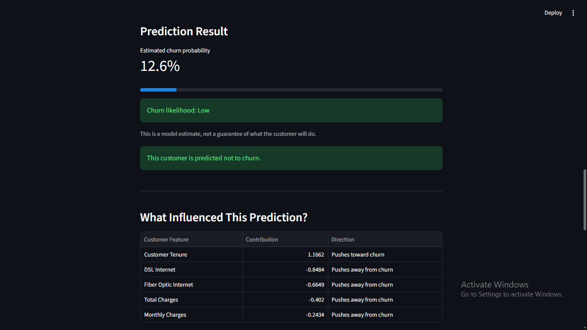
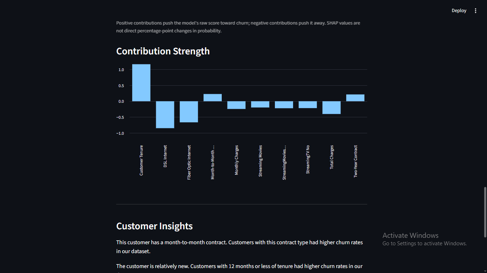

# Telco Customer Churn Prediction

A machine learning project that predicts customer churn using customer account information. It includes an interactive Streamlit application and SHAP-based explanations to help users understand individual predictions.

## Project Overview

Customer churn occurs when a customer stops using a company's services. This project uses a Logistic Regression classifier to estimate the likelihood that a telecommunications customer will leave.

The application allows users to enter customer details, receive a churn prediction, explore the predicted probability, and view features influencing the model's output.

**Live application:** [Try the Streamlit app](https://customer-churn-prediction-fehnkcwx59mgymo8xyqdyu.streamlit.app/)

## Features

- Data cleaning and preprocessing
- Scikit-learn pipeline combining preprocessing and Logistic Regression
- Hyperparameter tuning using GridSearchCV
- Churn probability prediction
- Adjustable classification threshold
- Individual prediction explanations using SHAP
- Interactive Streamlit interface
- Visualizations of feature contributions

## Technologies Used

- Python
- Pandas and NumPy
- Scikit-learn
- SHAP
- Streamlit
- Matplotlib
- Joblib

## Project Structure

```text
customer-churn-prediction/
├── WA_Fn-UseC_-Telco-Customer-Churn.csv
├── customer-churn-prediction.py
├── churn_model.pkl
├── predict.py
├── app.py
├── model_metrics.json
├── requirements.txt
└── README.md
```

## Installation and Setup

### 1. Clone the repository

```bash
git clone https://github.com/bprabhatreddy/customer-churn-prediction.git
cd customer-churn-prediction
```

### 2. Install dependencies

```bash
pip install -r requirements.txt
```

### 3. Run the application

```bash
streamlit run app.py
```

Open the local URL displayed in the terminal.

Ensure that the dataset, saved model, and configuration files required by the application are available in the project directory.

## Model and Evaluation

The project uses Logistic Regression within a Scikit-learn pipeline. Numerical features are scaled, and categorical features are one-hot encoded.

The training workflow includes stratified train/test splitting, cross-validation, and hyperparameter tuning. The application uses a classification threshold of **0.35** for its current deployed model.

### Baseline evaluation results

The recorded evaluation for the current model is:

| Metric | Score |
|---|---:|
| Test precision | 0.545 |
| Test recall | 0.711 |
| Test F1-score | 0.617 |
| ROC-AUC | 0.841 |

These results come from the existing recorded evaluation. Performance may differ on new data.

Precision measures how many customers predicted to churn actually churned. Recall measures how many actual churners the model identified. F1-score balances precision and recall, while ROC-AUC measures how well the model ranks churners above non-churners across classification thresholds.

## Model Explainability

SHAP is used to explain individual predictions by showing which features contribute toward or away from a prediction.

The application displays feature contributions in a table and chart. These explanations describe how the model arrived at its output; they do not establish that a feature causes customer churn.

## Limitations

- Model performance depends on the quality and representativeness of the training data.
- The dataset may not represent current customer behavior or other telecommunications providers.
- False positives and false negatives are unavoidable; a prediction is not a guarantee that a customer will leave.
- The application approximates total charges using monthly charges multiplied by tenure. This may differ from actual historical total charges.
- SHAP explanations describe model behavior, not causal relationships.
- The recorded evaluation is based on a held-out split of the available dataset and does not guarantee performance in real-world deployment.

## Future Improvements

- Validate model performance on an independent dataset.
- Compare models using consistent cross-validation and evaluation procedures.
- Evaluate different classification thresholds based on business costs.
- Improve input validation and handling of missing or inconsistent customer information.
- Expand monitoring and evaluation for real-world predictions.


## Screenshots

### Churn Prediction Result


### SHAP Explanations and Customer Insights

